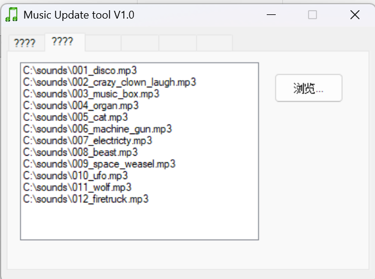
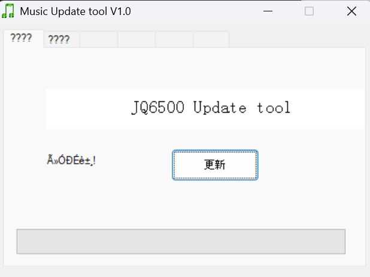

# Pumpkinator: Light and Sound Shows

The Pumpkinator's candle flicker, light shows, and sound effects all come from two places: the **code** running on the Arduino Nano, and the **MP3 files** stored on the sound card. This page shows how to load both, which is also how you would change the shows or swap in your own sounds.

:::note Tested on Windows only
These steps have only been tested on a Windows laptop. They may work on a Mac or Linux computer, but we haven't tried. The sound loading tools in particular (a Windows PowerShell script and `MusicDownload.exe`) are Windows programs.
:::

You will need a **micro USB cable** that can carry data (not just charge). The Arduino Nano and the sound card both use the same kind of cable.

## How to update the code on the Arduino

### 1. Install the Arduino IDE

The Arduino IDE is the free program used to write code and send it to the Arduino. [Download the Arduino IDE](https://www.arduino.cc/en/software) and install it with the default options.

### 2. Connect the Arduino to your laptop

Plug the micro USB cable into the Arduino Nano, and plug the other end into your laptop. A small power light on the Nano should come on.

As a precaution, keep the battery switch turned off while the USB cable is plugged in.

### 3. Make sure Windows can see the Arduino

Most Arduino Nano boards, including the ones in our kits, use a chip called a CH340 to talk to the computer. Windows needs to recognize it and give it a **COM port** (a name like `COM3`) before the Arduino IDE can talk to the board.

To check, right-click the Start button, choose **Device Manager**, and expand **Ports (COM & LPT)**. You should see something like `USB-SERIAL CH340 (COM3)`. Unplug the Arduino and plug it back in to see the entry disappear and reappear.

**If no COM port shows up**, work through these in order:

1. **Try a different USB cable.** Many micro USB cables are charge-only and have no data wires. This is the most common cause.
2. **Try a different USB port** on the laptop, preferably one directly on the laptop and not on a hub or dock.
3. **Look for a warning in Device Manager.** Under **Other devices**, or in the **Ports** list, look for an unknown device or a CH340 entry with a yellow warning icon. That means Windows doesn't have the driver. Install the CH340 driver using the [SparkFun CH340 driver guide](https://learn.sparkfun.com/tutorials/how-to-install-ch340-drivers), or download it directly from the [WCH driver page](https://www.wch-ic.com/downloads/CH341SER_EXE.html) (the maker of the chip). Run the installer, then unplug the Arduino and plug it back in.
4. **Restart the Arduino IDE** after plugging the board in. The port list sometimes doesn't refresh on its own.
5. **Check for a power light on the Nano.** If there's no light at all, the cable or the board has a problem. Try a different cable first.

### 4. Choose the port in the Arduino IDE

In the Arduino IDE, open the **Tools** menu, then **Port**, and choose the COM port that you saw in Device Manager (for example `COM3`). If you're not sure which one is the Arduino, open the menu, unplug the Arduino, and open the menu again: the port that disappeared is the right one.

### 5. Choose the type of Arduino

Open **Tools**, then **Board**, then **Arduino AVR Boards**, and choose **Arduino Nano**.

If you don't see **Arduino AVR Boards** in the list, open **Tools**, **Board**, **Boards Manager**, search for "Arduino AVR Boards", and install it.

### 6. Choose the processor (old bootloader)

Open **Tools**, then **Processor**, and choose **ATmega328P (Old Bootloader)**.

Most Nano clones need the old bootloader setting. If the upload fails later with an error like `programmer is not responding` or `not in sync`, come back to this menu and try the other option, **ATmega328P**. Also double check that the port from step 4 is still selected.

### 7. Get the Pumpkinator code

The Pumpkinator code lives in the team's GitHub project, [github.com/Fahrenheit6882/pumpkin](https://github.com/Fahrenheit6882/pumpkin). Download it to your laptop by clicking the green **Code** button and choosing **Download ZIP** (then unzip it), or by cloning it with git if you're familiar with that.

In the Arduino IDE, choose **File**, then **Open**, and open the file `pumpkin/pumpkin.ino` from inside the folder you just downloaded. This is the code for the full Pumpkinator.

### 8. Install the libraries the code needs

The code uses two libraries that don't come with the Arduino IDE. It won't compile until both are installed.

Open **Sketch**, then **Include Library**, then **Manage Libraries**. A panel opens on the left.

1. **FastLED:** search for `FastLED` and click **Install** on the one by Daniel Garcia. This is what controls the WS2812B LEDs.
2. **JQ6500_Serial:** search for `JQ6500` and install it if it appears. This is what sends play commands to the sound card. If it doesn't appear in the list, download it from the [JQ6500_Serial GitHub page](https://github.com/sleemanj/JQ6500_Serial) (**Code**, then **Download ZIP**). Then in the Arduino IDE choose **Sketch**, **Include Library**, **Add .ZIP Library**, and pick the ZIP file you downloaded.

To check that everything is installed, click the **Verify** button (the checkmark at the top left of the Arduino IDE). It compiles the code without sending it. If you see an error like `FastLED.h: No such file or directory` or `JQ6500_Serial.h: No such file or directory`, that library isn't installed yet.

### 9. Upload the code to the Arduino

Click the **Upload** button (the right-pointing arrow next to Verify). The Arduino IDE compiles the code, then sends it to the Arduino. The little lights on the Nano flash while it uploads. When it finishes, the bottom of the window says **Done uploading**.

After a few seconds, if the LEDs are connected, they should flicker like a candle. If the upload works but the lights don't behave right while the Arduino IDE is open, unplug the USB cable, close the Arduino IDE, and plug the cable back in.

**If the upload fails:**

| Error or symptom | What to try |
|---|---|
| `programmer is not responding` or `not in sync` | Try the other **Processor** option (step 6), double check the **Port** (step 4), and try a different USB cable |
| Port list is empty, or the port is grayed out | Go back to step 3: cable, USB port, and CH340 driver |
| `Access denied` or the port is busy | Close anything else that might be using the port, such as another Arduino IDE window or a serial monitor, then unplug and replug the Arduino |
| `No such file or directory` mentioning a `.h` file | A library is missing. Go back to step 8 |

## How to load MP3s onto the sound card

The sound card stores the sound effects itself, and the Arduino tells it which one to play. The sound files live in the same team GitHub project as the code, in the `sounds/pumpkin_files` folder, as 12 numbered MP3s (`001_disco.mp3`, `002_crazy_clown_laugh.mp3`, and so on).

Kits come with one of two sound cards, and they load sounds differently:

- **HW-896V2.0.2:** connect it, run a copy script, eject it.
- **True JQ6500:** connect it, run `MusicDownload.exe`, eject it.

Not sure which one you have? Step 3 shows how to tell.

### 1. Get the Pumpkinator project

You'll need the Pumpkinator project, because it contains the MP3s that match the `pumpkin.ino` code you loaded above. If you haven't already, download it from [github.com/Fahrenheit6882/pumpkin](https://github.com/Fahrenheit6882/pumpkin) (**Code**, then **Download ZIP**, then unzip it), as described in step 7 above.

### 2. Connect the sound card to your laptop

Plug a micro USB cable into the sound card, and plug the other end into your laptop. Make sure the Arduino isn't also plugged into the same laptop, so there's no confusion about which device is which.

A new drive should appear in Windows. Open **File Explorer**, choose **This PC**, and look for a new drive, shown as something like `USB Drive (D:)`. On our laptop it appears as `D:`, but the letter may be different on yours. Make a note of the letter.

**If no new drive appears:**

1. Try a different USB cable. As with the Arduino, charge-only cables are the most common cause.
2. Try a different USB port on the laptop.
3. Unplug the cable, wait a few seconds, and plug it back in.

### 3. Which sound card do you have?

Some kits come with an **HW-896V2.0.2** sound card, and some come with a **true JQ6500**. (The HW-896V2.0.2 is a clone of the JQ6500, so the two look almost identical and play sounds the same way.)

You can look for the model name printed on the chip, but the letters are tiny and really hard to read. It's usually easier to check how the card behaves. With the card plugged in, open its drive in File Explorer:

- If you see a **`MusicDownload.exe`** program, it's a **true JQ6500**.
- If the drive is **empty**, or it contains some **MP3 files**, it's an **HW-896V2.0.2**.

Then follow the matching section in step 4.

### 4. Load the sounds onto the sound card

:::info Why the order matters
The sound card plays files in the order they were **written** to it, not in alphabetical order. The code expects track 1 to be the disco sound, track 2 to be the clown laugh, and so on. So the files must be loaded one at a time, in number order, and leftover files from an earlier load would keep their old position. Both methods below take care of this.
:::

#### HW-896V2.0.2: copy script

:::caution Don't drag the MP3s onto the drive yourself
The drive is right there, so it's tempting, but dragging files over won't put them in the right order. Use the script.
:::

**Step 1: Run the script to copy the sounds in order.**

The project includes a script that copies the MP3s onto the sound card in the right order. It also deletes any old MP3 or WAV files already on the card first, because leftover files would keep their old position in the play order.

1. Open **PowerShell** in the project folder. In File Explorer, open the downloaded `pumpkin` project folder, click the address bar, type `powershell`, and press Enter.
2. Run this command, replacing `D:` with the drive letter you noted when you connected the sound card:

   ```powershell
   .\scripts\copy-sounds-in-order.ps1 -Destination D:
   ```

3. The script lists the files in playback order and then prints `Copied ...` for each one. When it finishes it prints `Done. Copied 12 file(s)`.

If PowerShell refuses to run the script with a message about scripts being disabled, run this version instead, which allows the script to run just this once:

```powershell
powershell -ExecutionPolicy Bypass -File .\scripts\copy-sounds-in-order.ps1 -Destination D:
```

To preview what the script would do without copying or deleting anything, add `-WhatIf` to the end of the command.

**Step 2: Unplug the sound card safely.**

In File Explorer, right-click the sound card drive and choose **Eject**, then unplug the USB cable. The sounds are now stored on the sound card, and it will keep them even with no power.

#### True JQ6500: MusicDownload.exe

The true JQ6500 doesn't work with the copy script. Instead, use its own loader program, **MusicDownload.exe**.

**Step 1: Load the MP3s with MusicDownload.exe.**

1. Run `MusicDownload.exe` from the sound card's drive.

   The app is sometimes in Chinese, which can be confusing. If you see `????` where the labels should be, don't worry. You can still do everything by following the position of the tabs and buttons below.
2. Click the **second tab** (it shows `????`), then click the **button with Chinese text on it**. A file picker opens. Go to the `sounds/pumpkin_files` folder of the Pumpkinator project, choose all **12 MP3s**, and click **OK**. Make sure the files end up in number order (`001_disco.mp3` first, then `002_...`, and so on). The order you load them in is the track order, so a wrong order means the wrong sounds play.

   

3. Click the **first tab** (also `????`), then click the **large button with Chinese text on it** to upload the files to the sound card.

   

4. Wait a while. It's confusing because the status text is in Chinese too, but if you look closely at the status area, it will say **done** followed by some strange characters when the upload has finished. Don't unplug the card before then.

If you're reloading a sound card that already has sounds, make sure the old ones are cleared out or replaced, so leftover files don't shift the track order.

**Step 2: Unplug the sound card safely.**

In File Explorer, right-click the sound card drive and choose **Eject**, then unplug the USB cable. The sounds are now stored on the sound card, and it will keep them even with no power.

### Using your own sounds

To use your own sounds, put your MP3 files in `sounds/pumpkin_files` with number prefixes (`001_...`, `002_...`) in the order you want, then load them onto the sound card again using step 4. The code also needs to know how long each sound is so it can time the light show: update the `TRACK_DURATIONS` list and `TRACK_COUNT` near the top of `pumpkin/pumpkin.ino`, then upload the code again using the steps above.
